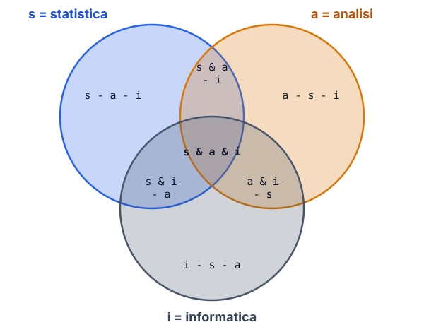

# Laboratorio 3 — Strutture dati

**Prerequisiti:** lezioni T11 (Liste e tuple), T12 (Dizionari e set) e T13 (Funzioni).

Oggi ci sono solo esercizi, in ordine di difficoltà, su liste, tuple, dizionari e set. Per ogni esercizio create un file `.py` con il nome indicato e scrivete il programma da soli. Le funzioni servono solo nella challenge. Si comincia con un riscaldamento di 10 passi brevi, tutti nello stesso file.

Ogni esercizio ha la consegna, un esempio di esecuzione e alcuni casi da provare: il programma è corretto quando dà gli stessi risultati. Sotto ogni consegna c'è anche «Da dove partire», lo scheletro del file: commenti e variabili, il resto lo scrivete voi. Alla fine c'è una challenge a scelta tra 5 temi, che chiude il laboratorio. Gli esercizi extra, in fondo, sono per casa: in laboratorio non si fanno e hanno la soluzione subito sotto la consegna. Il link «Soluzione →» di ogni esercizio porta al codice: apritelo dopo averci provato. Le soluzioni le vediamo all'inizio della lezione T14.

| # | File | Esercizio |
|---|---|---|
| Passi 1-10 | `riscaldamento.py` | Riscaldamento: liste, tuple, dizionari e set |
| 1 | `voti_appello.py` | L'appello di Statistica |
| 2 | `sondaggio.py` | Come arrivate in aula |
| 3 | `sessione.py` | La sessione invernale |
| Challenge | a scelta | Mercati e finanza · Sport · Imprese e marketing · Salute e scienza · Caso e probabilità |
| Extra 1 | `coda_mensa.py` | La coda in mensa (a casa) |
| Extra 2 | `tre_corsi.py` | Chi segue cosa (a casa) |
| Extra 3 | `libretto.py` | Il libretto (a casa) |
| Extra 4 | `contingenza.py` | Scuola di provenienza ed esito (a casa) |
| Extra 5 | `descrittive.py` | Ore di studio (a casa) |

---

## Promemoria

Gli strumenti che servono oggi. Da oggi si possono usare `sum()`, `min()`, `max()` e `sorted()`; l'unico import ammesso è `from collections import Counter, defaultdict`.

```python
from collections import Counter, defaultdict

voti: list[int] = [int(v) for v in "28 18 30".split()]
print(sum(voti), min(voti), sorted(voti))   # 76 18 [18, 28, 30]
voti.append(24)            # in fondo; voti.pop(0) toglie il primo
cfu: dict[str, int] = {"Analisi": 9, "Informatica": 6}
for esame, n in cfu.items():    # coppie (chiave, valore)
    print(esame, n)             # Analisi 9, poi Informatica 6
print(cfu.get("Inglese", 0))    # 0: la chiave non c'è
a: set[str] = {"Anna", "Bruno"}
b: set[str] = {"Bruno", "Carla"}
print(sorted(a | b), a & b, a - b)  # ['Anna', ...] {'Bruno'} {'Anna'}
print(Counter("abbccc").most_common(1))     # [('c', 3)]
gruppi: defaultdict[str, list[int]] = defaultdict(list)
gruppi["Analisi"].append(27)    # la lista vuota si crea da sola
```

---

## Riscaldamento (`riscaldamento.py`)

[Soluzione →](../../codice/L03_strutture_dati/esercizi.html#sol-riscaldamento)

Dieci passi brevi per provare una operazione alla volta su liste, tuple, dizionari e set.

### Passo 1 — Leggere una lista

- Partite da `corsi = ["Analisi", "Statistica", "Informatica", "Inglese"]`.
- Stampate il primo corso (`[0]`), l'ultimo (`[-1]`), quanti sono (`len()`) e i primi due con lo slicing `[:2]`.

```
Primo: Analisi
Ultimo: Inglese
Numero di corsi: 4
Primi due: ['Analisi', 'Statistica']
```

### Passo 2 — Aggiungere e togliere

- Ripartite dalla stessa lista `corsi` del passo 1.
- Uno alla volta: `append("Economia")`, `insert(0, "Fisica")`, `remove("Inglese")`. Dopo ognuno stampate la lista.
- Togliete l'ultimo corso con `pop()`, salvatelo in `tolto` e stampate `tolto` e la lista.
- Prima di eseguire scrivete in un commento come pensate che diventi la lista.

```
['Analisi', 'Statistica', 'Informatica', 'Inglese', 'Economia']
['Fisica', 'Analisi', 'Statistica', 'Informatica', 'Inglese', 'Economia']
['Fisica', 'Analisi', 'Statistica', 'Informatica', 'Economia']
Tolto: Economia, restano ['Fisica', 'Analisi', 'Statistica', 'Informatica']
```

### Passo 3 — Cercare e contare

- Partite da `voti = [24, 18, 30, 18, 27]`.
- Con `in` controllate se ci sono un 30 e un 17; con `count()` contate i 18; con `index()` trovate la posizione del 30.
- Stampate somma, minimo, massimo e la media con due decimali.

```
30 c'è? True  17 c'è? False
Quanti 18: 2
Posizione del 30: 2
Somma 117, minimo 18, massimo 30
Media: 23.40
```

### Passo 4 — sorted() e sort()

- Stessa lista `voti` del passo 3.
- Stampate `sorted(voti)` e poi `voti`: la lista di partenza non è cambiata. Stampate anche `sorted(voti, reverse=True)`.
- Stampate `voti.sort()` e poi `voti`: `sort()` ordina la lista stessa e restituisce `None`.

```
sorted: [18, 18, 24, 27, 30]
voti dopo sorted: [24, 18, 30, 18, 27]
dal più alto: [30, 27, 24, 18, 18]
risultato di sort: None
voti dopo sort: [18, 18, 24, 27, 30]
```

### Passo 5 — Due nomi, una lista

- Scrivete `voti = [24, 18, 30]`, poi `altri = voti` e `altri.append(0)`. Stampate `voti`: è cambiata anche lei, perché i due nomi indicano la stessa lista.
- Ora `copia = voti.copy()` e `copia.append(99)`. Stampate `voti` e `copia`: la copia è una lista nuova e `voti` non cambia.

```
voti: [24, 18, 30, 0]
voti: [24, 18, 30, 0]  copia: [24, 18, 30, 0, 99]
```

### Passo 6 — Tuple

- Partite da `esame = ("Statistica", 6, 28)`. Spacchettatela in `nome, cfu, voto` e stampate la prima riga dell'output.
- Stampate quanti elementi ha la tupla e il primo.
- Provate `esame[2] = 30`, leggete l'errore e poi commentate la riga: una tupla non si può modificare.

```
Statistica: 6 CFU, voto 28
Elementi: 3, primo: Statistica
TypeError: 'tuple' object does not support item assignment
```

### Passo 7 — Dizionario: chiavi e valori

- Partite da `crediti = {"Analisi": 9, "Statistica": 6}`.
- Aggiungete `"Informatica"` con 9 CFU, portate `"Statistica"` a 9 e cancellate `"Analisi"` con `del`. Stampate il dizionario.
- Controllate con `in` se c'è `"Inglese"` e leggetelo con `get("Inglese", 0)`.
- Provate `crediti["Inglese"]`, leggete l'errore e poi commentate la riga.

```
{'Statistica': 9, 'Informatica': 9}
Inglese c'è? False
CFU di Inglese: 0
KeyError: 'Inglese'
```

### Passo 8 — Dizionario: il ciclo

- Partite da `crediti = {"Analisi": 9, "Statistica": 6, "Informatica": 9, "Inglese": 3}`.
- Con un ciclo su `items()` stampate ogni esame con i suoi CFU, poi il totale con `sum(crediti.values())`.
- Con una comprehension su `items()` tenete gli esami da 9 CFU.

```
Analisi: 9 CFU
Statistica: 6 CFU
Informatica: 9 CFU
Inglese: 3 CFU
Totale: 27 CFU
Esami da 9 CFU: ['Analisi', 'Informatica']
```

### Passo 9 — Set

- Partite da `a = {"Anna", "Bruno", "Carla"}` e `b = {"Bruno", "Davide"}`.
- Eseguite `a.add("Anna")` e stampate `len(a)`: Anna c'era già, quindi gli elementi restano 3.
- Stampate unione `|`, intersezione `&`, differenza `-` e differenza simmetrica `^`, sempre dentro `sorted()`.
- Con `presenze = ["Anna", "Bruno", "Anna", "Carla", "Bruno"]` e `set()` contate le persone diverse.

```
Elementi di a: 3
a | b: ['Anna', 'Bruno', 'Carla', 'Davide']
a & b: ['Bruno']
a - b: ['Anna', 'Carla']
a ^ b: ['Anna', 'Carla', 'Davide']
Presenze: 5, persone diverse: 3
```

### Passo 10 — Counter e defaultdict

- Con `lettere = Counter("statistica")` stampate quante `t` e quante `z` ci sono (una chiave assente vale 0) e le due lettere più frequenti con `most_common(2)`.
- Con `prove = [("Anna", 28), ("Bruno", 24), ("Anna", 30)]` raggruppate i voti per nome in un `defaultdict(list)` e stampate ogni nome con la sua lista.

```
Quante t: 3  quante z: 0
Le due più frequenti: [('t', 3), ('s', 2)]
Anna: [28, 30]
Bruno: [24]
```

---

## Esercizio 1 — L'appello di Statistica (`voti_appello.py`)

[Soluzione →](../../codice/L03_strutture_dati/esercizi.html#sol-voti_appello)
**Consegna**

1. Chiedete i voti dell'appello su una riga, separati da spazi, e trasformateli in una lista di interi con `split()` e una list comprehension.
2. Stampate la lista ordinata (`sorted()`), il numero di presenti, la media con un decimale, il voto minimo e il massimo.
3. Con una seconda comprehension tenete i voti da 18 in su: stampate quanti sono, la loro percentuale con un decimale e la loro media.
4. Se nessuno è promosso, la media dei promossi non va stampata.

**Da dove partire**

I commenti numerati seguono i passi della consegna e ogni commento corrisponde a una riga di codice, da scrivere subito sotto. Al posto di `...` scrivete il vostro codice.

```python
SOGLIA: int = 18

# 1. leggo la riga e la trasformo in una lista di interi
testo: str = input("Voti separati da spazi: ")
voti: list[int] = ...

# 2. stampo la lista ordinata
# stampo il numero di presenti
# stampo la media con un decimale
# stampo minimo e massimo

# 3. tengo i voti da SOGLIA in su
promossi: list[int] = ...
# stampo quanti sono e la loro percentuale

# 4. se c'è almeno un promosso:
#     calcolo la media dei promossi
#     la stampo
```

**Esempio di esecuzione**

```
Voti separati da spazi: 24 18 30 15 27 22 30 12 26 19
Voti ordinati: [12, 15, 18, 19, 22, 24, 26, 27, 30, 30]
Presenti: 10
Media: 22.3
Minimo: 12  Massimo: 30
Promossi: 8 (80.0%)
Media dei promossi: 24.5
```

**Provate anche**

- `30 30 30` → `Promossi: 3 (100.0%)`
- `12 15` → `Promossi: 0 (0.0%)` e nessuna media dei promossi
- `18` → un voto solo: media, minimo e massimo valgono 18

---

## Esercizio 2 — Come arrivate in aula (`sondaggio.py`)

[Soluzione →](../../codice/L03_strutture_dati/esercizi.html#sol-sondaggio)
**Consegna**

1. Alle matricole è stato chiesto con quale mezzo arrivano in università. Chiedete le risposte su una riga, separate da virgole.
2. Pulite ogni risposta con `strip()` e `lower()`, così `Bus` e ` bus` diventano uguali, e scartate le risposte vuote.
3. Contate le risposte con un `Counter`. Stampate il numero di risposte e di mezzi diversi, poi ogni mezzo dal più frequente (`most_common()`) con il conteggio e la percentuale con un decimale.
4. Stampate infine il mezzo più usato, cioè la moda.

**Da dove partire**

I commenti numerati seguono i passi della consegna e ogni commento corrisponde a una riga di codice, da scrivere subito sotto. Al posto di `...` scrivete il vostro codice.

```python
from collections import Counter

# 1. leggo le risposte
testo: str = input("Risposte separate da virgole: ")

# 2. divido sulle virgole e pulisco ogni pezzo (strip e lower)
risposte: list[str] = ...
# tolgo le risposte vuote

# 3. conto le risposte
conteggio: Counter[str] = ...
totale: int = ...
# stampo il numero di risposte e di mezzi diversi
# per ogni coppia (mezzo, n) di most_common():
#     stampo mezzo, conteggio e percentuale

# 4. il mezzo più usato: il primo elemento di most_common(1)
moda: str = ...
# lo stampo
```

**Esempio di esecuzione**

```
Risposte separate da virgole: bici, Bus, piedi, bici, treno, BICI, bus, piedi, bici, monopattino, bus, treno
Risposte: 12, mezzi diversi: 5
bici: 4 (33.3%)
bus: 3 (25.0%)
piedi: 2 (16.7%)
treno: 2 (16.7%)
monopattino: 1 (8.3%)
Mezzo più usato: bici
```

**Provate anche**

- `auto` → `auto: 1 (100.0%)`
- `bus,,Bus , treno` → 3 risposte, `bus: 2 (66.7%)`

---

## Esercizio 3 — La sessione invernale (`sessione.py`)

[Soluzione →](../../codice/L03_strutture_dati/esercizi.html#sol-sessione)
**Consegna**

1. Scrivete gli esiti come lista di tuple (studente, esame, voto), nell'ordine della tabella: `esiti: list[tuple[str, str, int]]`.
2. In un solo ciclo riempite due `defaultdict(list)`: esame → voti, studente → esami superati (voto da 18 in su). Raccogliete anche tutti i nomi in un set.
3. Per ogni esame stampate il numero di prove, la media con un decimale e i promossi.
4. Per ogni studente, in ordine alfabetico, stampate gli esami superati; poi stampate chi non ne ha superato nessuno (differenza tra set).

| Studente | Esame e voto |
|---|---|
| Anna | Statistica 28, Analisi 30 |
| Bruno | Statistica 16, Analisi 17, Informatica 23 |
| Chiara | Analisi 25, Statistica 30 |
| Davide | Statistica 21, Informatica 26 |
| Elisa | Analisi 12 |

**Da dove partire**

I commenti numerati seguono i passi della consegna e ogni commento corrisponde a una riga di codice, da scrivere subito sotto. Al posto di `...` scrivete il vostro codice.

```python
from collections import defaultdict

# 1. gli esiti, nell'ordine della tabella
esiti: list[tuple[str, str, int]] = [
    ("Anna", "Statistica", 28), ("Anna", "Analisi", 30),
    # continuate con Bruno, Chiara, Davide ed Elisa
]

# 2. le tre strutture da riempire in un solo ciclo
voti_esame: defaultdict[str, list[int]] = defaultdict(list)  # esame -> voti
superati: defaultdict[str, list[str]] = defaultdict(list)    # nome -> esami
studenti: set[str] = set()                                   # tutti i nomi
# per ogni (nome, esame, voto) in esiti:
#     aggiungo il voto alla lista del suo esame
#     aggiungo il nome al set
#     se il voto è da 18 in su:
#         aggiungo l'esame alla lista dello studente

# 3. per ogni (esame, voti) di voti_esame:
#     conto i promossi
#     stampo prove, media e promossi

# 4. per ogni nome di superati, in ordine alfabetico:
#     stampo i suoi esami superati
# stampo chi è in studenti ma non in superati (differenza tra set)
```

**Esempio di esecuzione**

```
Statistica: 4 prove, media 23.8, promossi 3
Analisi: 4 prove, media 21.0, promossi 2
Informatica: 2 prove, media 24.5, promossi 2
Anna ha superato ['Statistica', 'Analisi']
Bruno ha superato ['Informatica']
Chiara ha superato ['Analisi', 'Statistica']
Davide ha superato ['Statistica', 'Informatica']
Nessun esame superato: ['Elisa']
```

**Provate anche**

- aggiungete `("Elisa", "Statistica", 18)` → `Statistica: 5 prove, media 22.6, promossi 4` e `Nessun esame superato: []`

---

## Challenge a scelta

Scegliete un tema. Le cinque challenge hanno la stessa difficoltà e usano gli stessi strumenti: cambiano la storia e i dati. Ogni tema continua nei laboratori successivi.

| Tema | Challenge | File |
|---|---|---|
| Mercati e finanza | Il portafoglio | `ch_mercati.py` |
| Sport | Il campionato | `ch_sport.py` |
| Imprese e marketing | Il negozio online | `ch_negozio.py` |
| Salute e scienza | Lo studio clinico | `ch_salute.py` |
| Caso e probabilità | Il tavolo da gioco | `ch_probabilita.py` |

**Tutte le challenge chiedono:**

- Ogni challenge usa: una lista di tuple con i dati, scritta nel codice copiando la tabella o la consegna.
- Un raggruppamento con `defaultdict(list)` e un `Counter`, letto con `most_common(1)`.
- Una list comprehension con filtro e una percentuale stampata con `.1%`.
- Un'operazione tra set (`-`, `&` o `|`), stampata con `sorted()` così l'ordine è sempre lo stesso.
- Una funzione `def` con type hints e docstring che restituisce una tupla di due valori, spacchettata da chi la chiama.
- L'unico import è `from collections import Counter, defaultdict`; niente `random`, `lambda`, `sorted` con `key` e `try`. L'output ha da 6 a 7 righe, come nell'esempio.

---

### Challenge · Mercati e finanza — Il portafoglio (`ch_mercati.py`)

[Soluzione →](../../codice/L03_strutture_dati/esercizi.html#sol-ch_mercati)
**Consegna**

1. Uno studente investe su tre titoli fittizi: `ENRG` (energia), `BANK` (banca) e `TECH` (tecnologia). Scrivete i suoi ordini come lista di tuple (titolo, quantità, prezzo), `ordini: list[tuple[str, int, float]]`, con i dati della tabella. Una quantità negativa è una vendita.
2. Scrivete `escursione(prezzi: list[float]) -> tuple[float, float]`, che restituisce il prezzo minimo e il prezzo massimo.
3. In un solo ciclo raggruppate i prezzi per titolo in un `defaultdict(list)` e sommate le quantità in un `Counter` chiamato `portafoglio`. Per ogni titolo, in ordine alfabetico, stampate il numero di ordini, il prezzo minimo e massimo con due decimali e le azioni in portafoglio.
4. Stampate la posizione più grande con `most_common(1)`. Con una comprehension con filtro tenete le vendite e stampate quante sono e la loro percentuale sugli ordini.
5. Costruite il set dei titoli comprati e quello dei titoli venduti e, con una differenza, stampate i titoli mai venduti.

| Titolo | Ordini (quantità a prezzo) |
|---|---|
| ENRG | 30 a 12.40, 20 a 12.10, -10 a 13.05 |
| BANK | 20 a 8.15, -5 a 8.60, 10 a 8.30, -5 a 8.75 |
| TECH | 10 a 45.20, 5 a 47.80, 5 a 44.90 |

**Da dove partire**

I commenti numerati seguono i passi della consegna e ogni commento corrisponde a una riga di codice, da scrivere subito sotto. Al posto di `...` scrivete il vostro codice.

```python
from collections import Counter, defaultdict


def escursione(prezzi: list[float]) -> tuple[float, float]:
    """Restituisce il prezzo minimo e il prezzo massimo."""
    # restituisco minimo e massimo della lista
    ...


# 1. gli ordini (titolo, quantità, prezzo); quantità negativa = vendita
ordini: list[tuple[str, int, float]] = [
    ("ENRG", 30, 12.40), ("ENRG", 20, 12.10), ("ENRG", -10, 13.05),
    # continuate con BANK e TECH
]

# 3. prezzi per titolo e azioni in portafoglio
prezzi: defaultdict[str, list[float]] = defaultdict(list)
portafoglio: Counter[str] = Counter()
# per ogni (titolo, quantità, prezzo) in ordini:
#     aggiungo il prezzo alla lista del titolo
#     sommo la quantità nel portafoglio
# per ogni titolo, in ordine alfabetico:
#     chiamo escursione e spacchetto minimo e massimo
#     stampo ordini, prezzi e azioni

# 4. la posizione più grande
# prendo la prima coppia di most_common(1) e la stampo
vendite: list[tuple[str, int, float]] = ...  # ordini con quantità < 0
# stampo quante sono e la percentuale sugli ordini

# 5. i titoli mai venduti
comprati: set[str] = ...
venduti: set[str] = ...
# stampo la differenza, ordinata
```

**Esempio di esecuzione**

```
BANK: 4 ordini, prezzo da 8.15 a 8.75, in portafoglio 20
ENRG: 3 ordini, prezzo da 12.10 a 13.05, in portafoglio 40
TECH: 3 ordini, prezzo da 44.90 a 47.80, in portafoglio 20
Posizione più grande: ENRG con 40 azioni
Vendite: 3 su 10 (30.0%)
Mai venduti: ['TECH']
```

**Provate anche**

- aggiungete `("TECH", -20, 50.10)` → `TECH: 4 ordini, prezzo da 44.90 a 50.10, in portafoglio 0`, `Vendite: 4 su 11 (36.4%)` e `Mai venduti: []`
- aggiungete `("BANK", 30, 8.40)` → `Posizione più grande: BANK con 50 azioni`

---

### Challenge · Sport — Il campionato (`ch_sport.py`)

[Soluzione →](../../codice/L03_strutture_dati/esercizi.html#sol-ch_sport)
**Consegna**

1. Il campionato ha quattro piloti: Ferri e Lanza corrono per la Scuderia Rossa, Moro e Neri per la Scuderia Blu. Scrivete l'ordine d'arrivo di ogni gara come tupla di quattro nomi, dal primo al quarto, e mettete le cinque tuple nella lista `gare` (tabella). Scrivete anche `rossa: set[str] = {"Ferri", "Lanza"}`.
2. Scrivete `bilancio(posizioni: list[int]) -> tuple[int, int]`: riceve i piazzamenti di un pilota (da 1 a 4) e restituisce i punti totali, con `PUNTI = [25, 18, 15, 12]`, e il miglior piazzamento.
3. In un ciclo raggruppate i piazzamenti per pilota in un `defaultdict(list)` e contate le vittorie con un `Counter`. Per ogni pilota, in ordine alfabetico, stampate punti e miglior piazzamento.
4. Stampate il pilota con più vittorie (`most_common(1)`). Con una comprehension con filtro tenete i vincitori della Scuderia Rossa e stampate quante gare ha vinto la scuderia e in che percentuale.
5. Con una differenza tra set (piloti e vincitori) stampate i piloti senza vittorie.

| Gara | Ordine d'arrivo |
|---|---|
| 1 | Ferri, Moro, Lanza, Neri |
| 2 | Moro, Ferri, Neri, Lanza |
| 3 | Ferri, Lanza, Moro, Neri |
| 4 | Moro, Lanza, Ferri, Neri |
| 5 | Moro, Neri, Ferri, Lanza |

**Da dove partire**

I commenti numerati seguono i passi della consegna e ogni commento corrisponde a una riga di codice, da scrivere subito sotto. Al posto di `...` scrivete il vostro codice.

```python
from collections import Counter, defaultdict

PUNTI: list[int] = [25, 18, 15, 12]


def bilancio(posizioni: list[int]) -> tuple[int, int]:
    """Restituisce i punti totali e il miglior piazzamento."""
    # trasformo ogni piazzamento p nei punti PUNTI[p - 1]
    # restituisco la somma dei punti e il piazzamento minimo
    ...


# 1. la Scuderia Rossa e le gare (dal primo al quarto)
rossa: set[str] = {"Ferri", "Lanza"}
gare: list[tuple[str, str, str, str]] = [
    ("Ferri", "Moro", "Lanza", "Neri"),
    # continuate con le gare da 2 a 5
]

# 3. piazzamenti per pilota e vittorie
posizioni: defaultdict[str, list[int]] = defaultdict(list)
vittorie: Counter[str] = Counter()
# per ogni arrivo in gare:
#     conto una vittoria per il primo pilota
#     per ogni indice i dell'arrivo:
#         aggiungo i + 1 ai piazzamenti di quel pilota
# per ogni pilota, in ordine alfabetico:
#     chiamo bilancio e spacchetto punti e miglior piazzamento
#     stampo

# 4. il pilota con più vittorie
# prendo la prima coppia di most_common(1) e la stampo
vinte: list[str] = ...  # vincitori che sono in rossa
# stampo quante gare e la percentuale

# 5. i piloti senza vittorie
# stampo i piloti di posizioni che non sono in vittorie, ordinati
```

**Esempio di esecuzione**

```
Ferri: 98 punti, miglior piazzamento 1
Lanza: 75 punti, miglior piazzamento 2
Moro: 108 punti, miglior piazzamento 1
Neri: 69 punti, miglior piazzamento 2
Più vittorie: Moro con 3
Gare vinte dalla Scuderia Rossa: 2 su 5 (40.0%)
Senza vittorie: ['Lanza', 'Neri']
```

**Provate anche**

- aggiungete la gara `("Neri", "Lanza", "Moro", "Ferri")` → `Neri: 94 punti, miglior piazzamento 1`, `Gare vinte dalla Scuderia Rossa: 2 su 6 (33.3%)` e `Senza vittorie: ['Lanza']`
- `PUNTI = [10, 6, 4, 3]` → `Ferri: 34 punti` e `Moro: 40 punti`; le altre righe non cambiano

---

### Challenge · Imprese e marketing — Il negozio online (`ch_negozio.py`)

[Soluzione →](../../codice/L03_strutture_dati/esercizi.html#sol-ch_negozio)
**Consegna**

1. Un negozio online vende cinque prodotti per lo studio: scrivete i prezzi della tabella in `prezzi: dict[str, float]`. Gli ordini della settimana sono tuple (cliente, prodotto, quantità): `[("Irene", "zaino", 1), ("Tommaso", "quaderno", 5), ("Giada", "cuffie", 1), ("Pietro", "borraccia", 2), ("Irene", "quaderno", 3), ("Noemi", "zaino", 1), ("Tommaso", "borraccia", 1), ("Irene", "cuffie", 1), ("Giada", "quaderno", 4), ("Noemi", "borraccia", 2)]`.
2. Scrivete `vendite(quantita: list[int]) -> tuple[int, int]`, che restituisce il numero di ordini e il numero di pezzi.
3. In un ciclo raggruppate le quantità per prodotto in un `defaultdict(list)` e contate gli ordini di ogni cliente con un `Counter`. Per ogni prodotto venduto, in ordine alfabetico, stampate ordini, pezzi e incasso (pezzi × prezzo) con due decimali.
4. Stampate il cliente con più ordini (`most_common(1)`). Con una comprehension con filtro tenete gli ordini con più di un pezzo e stampate quanti sono e la loro percentuale.
5. Con una differenza tra set (i prodotti di `prezzi` e quelli venduti) stampate i prodotti mai venduti.

| Prodotto | Prezzo (euro) |
|---|---|
| zaino | 39.90 |
| borraccia | 12.50 |
| quaderno | 3.20 |
| cuffie | 24.90 |
| lampada | 18.00 |

**Da dove partire**

I commenti numerati seguono i passi della consegna e ogni commento corrisponde a una riga di codice, da scrivere subito sotto. Al posto di `...` scrivete il vostro codice.

```python
from collections import Counter, defaultdict


def vendite(quantita: list[int]) -> tuple[int, int]:
    """Restituisce il numero di ordini e il numero di pezzi."""
    # restituisco la lunghezza della lista e la somma
    ...


# 1. i prezzi e gli ordini (cliente, prodotto, quantità)
prezzi: dict[str, float] = {
    "zaino": 39.90,
    # continuate con la tabella
}
ordini: list[tuple[str, str, int]] = [
    ("Irene", "zaino", 1), ("Tommaso", "quaderno", 5),
    # continuate con la consegna
]

# 3. quantità per prodotto e ordini per cliente
pezzi: defaultdict[str, list[int]] = defaultdict(list)
clienti: Counter[str] = Counter()
# per ogni (cliente, prodotto, quantità) in ordini:
#     aggiungo la quantità alla lista del prodotto
#     conto un ordine per il cliente
# per ogni prodotto di pezzi, in ordine alfabetico:
#     chiamo vendite e spacchetto ordini e pezzi
#     stampo ordini, pezzi e incasso (pezzi × prezzo)

# 4. il cliente più assiduo
# prendo la prima coppia di most_common(1) e la stampo
multipli: list[tuple[str, str, int]] = ...  # ordini con più di un pezzo
# stampo quanti sono e la percentuale

# 5. i prodotti mai venduti
# stampo le chiavi di prezzi che non sono in pezzi, ordinate
```

**Esempio di esecuzione**

```
borraccia: 3 ordini, 5 pezzi, incasso 62.50 euro
cuffie: 2 ordini, 2 pezzi, incasso 49.80 euro
quaderno: 3 ordini, 12 pezzi, incasso 38.40 euro
zaino: 2 ordini, 2 pezzi, incasso 79.80 euro
Cliente più assiduo: Irene con 3 ordini
Ordini con più di un pezzo: 5 su 10 (50.0%)
Mai venduti: ['lampada']
```

**Provate anche**

- aggiungete `("Pietro", "lampada", 2)` → `Ordini con più di un pezzo: 6 su 11 (54.5%)` e `Mai venduti: []`
- aggiungete `("Pietro", "zaino", 2)` → `zaino: 3 ordini, 4 pezzi, incasso 159.60 euro`

---

### Challenge · Salute e scienza — Lo studio clinico (`ch_salute.py`)

[Soluzione →](../../codice/L03_strutture_dati/esercizi.html#sol-ch_salute)
**Consegna**

1. Uno studio prova un integratore per la pressione su 10 pazienti, metà nel gruppo `trattamento` e metà nel gruppo `controllo`. Scrivete i dati come lista di tuple (codice, gruppo, pressione sistolica prima, dopo), `pazienti: list[tuple[str, str, int, int]]` (tabella). P07 non è tornato alla seconda visita: la sua pressione dopo è registrata come 0.
2. Con una comprehension con filtro tenete i pazienti con la misura dopo maggiore di 0 e stampate quanti sono e la loro percentuale. Con una differenza tra set di codici stampate chi non ha la seconda misura.
3. Scrivete `variazione(differenze: list[int]) -> tuple[int, float]`, che restituisce il numero di pazienti e la variazione media (dopo − prima).
4. Sui pazienti validi raggruppate le variazioni per gruppo in un `defaultdict(list)` e contate per gruppo i migliorati, cioè chi è sceso di almeno 10 mmHg, con un `Counter`. Per ogni gruppo, in ordine alfabetico, stampate pazienti, variazione media con un decimale e migliorati.
5. Stampate il totale dei migliorati sui pazienti validi e il gruppo con più migliorati (`most_common(1)`).

| Paziente | Gruppo, pressione prima → dopo (mmHg) |
|---|---|
| P01 | trattamento, 152 → 138 |
| P02 | controllo, 148 → 145 |
| P03 | trattamento, 160 → 147 |
| P04 | controllo, 155 → 150 |
| P05 | trattamento, 145 → 140 |
| P06 | controllo, 150 → 152 |
| P07 | trattamento, 158 → 0 |
| P08 | controllo, 149 → 138 |
| P09 | trattamento, 162 → 148 |
| P10 | controllo, 157 → 155 |

**Da dove partire**

I commenti numerati seguono i passi della consegna e ogni commento corrisponde a una riga di codice, da scrivere subito sotto. Al posto di `...` scrivete il vostro codice.

```python
from collections import Counter, defaultdict


def variazione(differenze: list[int]) -> tuple[int, float]:
    """Restituisce il numero di pazienti e la variazione media."""
    # restituisco la lunghezza della lista e la media
    ...


# 1. i pazienti (codice, gruppo, prima, dopo); dopo = 0 se manca
pazienti: list[tuple[str, str, int, int]] = [
    ("P01", "trattamento", 152, 138), ("P02", "controllo", 148, 145),
    # continuate con la tabella
]

# 2. i pazienti validi e quelli senza seconda misura
validi: list[tuple[str, str, int, int]] = ...  # misura dopo > 0
# stampo quanti sono e la percentuale
persi: set[str] = ...  # codici di tutti meno codici dei validi
# stampo persi, ordinati

# 4. variazioni e migliorati, per gruppo
differenze: defaultdict[str, list[int]] = defaultdict(list)
migliorati: Counter[str] = Counter()
# per ogni (codice, gruppo, prima, dopo) in validi:
#     aggiungo dopo - prima alla lista del gruppo
#     se dopo - prima vale -10 o meno:
#         conto un migliorato per il gruppo
# per ogni gruppo, in ordine alfabetico:
#     chiamo variazione e spacchetto pazienti e media
#     stampo pazienti, media e migliorati

# 5. il totale dei migliorati
# stampo la somma dei valori di migliorati e quanti sono i validi
# prendo la prima coppia di most_common(1) e la stampo
```

**Esempio di esecuzione**

```
Misure valide: 9 su 10 (90.0%)
Senza seconda misura: ['P07']
controllo: 5 pazienti, variazione media -3.8 mmHg, migliorati 1
trattamento: 4 pazienti, variazione media -11.5 mmHg, migliorati 3
Migliorati: 4 su 9
Gruppo con più migliorati: trattamento (3)
```

**Provate anche**

- P07 con la misura dopo `145` → `Misure valide: 10 su 10 (100.0%)`, `Senza seconda misura: []` e `trattamento: 5 pazienti, variazione media -11.8 mmHg, migliorati 4`
- aggiungete `("P11", "controllo", 151, 0)` → `Misure valide: 9 su 11 (81.8%)` e `Senza seconda misura: ['P07', 'P11']`

---

### Challenge · Caso e probabilità — Il tavolo da gioco (`ch_probabilita.py`)

[Soluzione →](../../codice/L03_strutture_dati/esercizi.html#sol-ch_probabilita)
**Consegna**

1. Ada, Bea e Ciro giocano con due dadi e annotano ogni lancio come tupla (giocatore, primo dado, secondo dado). Scrivete la lista `lanci: list[tuple[str, int, int]]` con i 12 lanci della tabella.
2. Scrivete `riassunto(somme: list[int]) -> tuple[float, int]`, che restituisce la somma media e la somma più alta.
3. In un ciclo raggruppate le somme dei due dadi per giocatore in un `defaultdict(list)` e contate quante volte esce ogni somma con un `Counter`. Per ogni giocatore, in ordine alfabetico, stampate la somma media con due decimali e la somma più alta.
4. Stampate la somma uscita più spesso (`most_common(1)`). Con una comprehension con filtro tenete i doppi (due dadi uguali) e stampate quanti sono e la loro percentuale.
5. Con una set comprehension su due cicli costruite tutte le somme possibili con due dadi; con una differenza tra set stampate le somme mai uscite.

| Giocatore | Lanci (primo e secondo dado) |
|---|---|
| Ada | 3 e 4, 1 e 3, 6 e 5, 2 e 2 |
| Bea | 6 e 6, 5 e 2, 3 e 1, 4 e 3 |
| Ciro | 2 e 5, 4 e 4, 6 e 2, 5 e 3 |

**Da dove partire**

I commenti numerati seguono i passi della consegna e ogni commento corrisponde a una riga di codice, da scrivere subito sotto. Al posto di `...` scrivete il vostro codice.

```python
from collections import Counter, defaultdict


def riassunto(somme: list[int]) -> tuple[float, int]:
    """Restituisce la somma media e la somma più alta."""
    # restituisco la media e il massimo della lista
    ...


# 1. i lanci (giocatore, primo dado, secondo dado)
lanci: list[tuple[str, int, int]] = [
    ("Ada", 3, 4), ("Ada", 1, 3), ("Ada", 6, 5), ("Ada", 2, 2),
    # continuate con Bea e Ciro
]

# 3. somme per giocatore e quante volte esce ogni somma
somme: defaultdict[str, list[int]] = defaultdict(list)
uscite: Counter[int] = Counter()
# per ogni (giocatore, d1, d2) in lanci:
#     aggiungo d1 + d2 alla lista del giocatore
#     conto un'uscita per la somma d1 + d2
# per ogni giocatore, in ordine alfabetico:
#     chiamo riassunto e spacchetto media e somma più alta
#     stampo

# 4. la somma più uscita
# prendo la prima coppia di most_common(1) e la stampo
doppi: list[tuple[str, int, int]] = ...  # lanci con i due dadi uguali
# stampo quanti sono e la percentuale

# 5. le somme mai uscite
possibili: set[int] = ...  # a + b con a e b da 1 a 6
# stampo le possibili che non sono in uscite, ordinate
```

**Esempio di esecuzione**

```
Ada: somma media 6.50, più alta 11
Bea: somma media 7.50, più alta 12
Ciro: somma media 7.75, più alta 8
Somma più uscita: 7 (4 volte)
Doppi: 3 su 12 (25.0%)
Somme mai uscite: [2, 3, 5, 6, 9, 10]
```

**Provate anche**

- aggiungete `("Ada", 5, 5)` → `Ada: somma media 7.20, più alta 11`, `Doppi: 4 su 13 (30.8%)` e `Somme mai uscite: [2, 3, 5, 6, 9]`
- aggiungete `("Bea", 1, 1)` → `Somme mai uscite: [3, 5, 6, 9, 10]`

---

## Domande di verifica

1. Che differenza c'è tra `sorted(voti)` e `voti.sort()`? Quale dei due modifica la lista?
2. In `coda_mensa.py`, cosa succede con `coda.remove("Zeno")` se prima non si controlla con `in`?
3. In `sondaggio.py`, perché le risposte vanno pulite prima di passarle a `Counter`?
4. Perché, per stampare un set, conviene usare `sorted()`?
5. In `libretto.py`, quando la media ponderata coincide con la media aritmetica?
6. In `contingenza.py` le chiavi del `Counter` sono tuple. Si potrebbero usare liste? Perché?
7. In `descrittive.py` (Extra 5) la funzione restituisce tre valori: che tipo ha il risultato e come si separa in tre variabili?

---

## Esercizi extra

Questi esercizi non si fanno in laboratorio: sono materiale in più per allenarsi a casa, nello stesso ordine di difficoltà. Sotto ogni consegna c'è la soluzione: provate prima da soli e guardatela solo alla fine, per confrontarla con la vostra.

---

## Extra 1 — La coda in mensa (`coda_mensa.py`)

[Soluzione →](../../codice/L03_strutture_dati/esercizi.html#sol-coda_mensa)

**Consegna**

1. Partite da `coda: list[str] = ["Anna", "Bruno", "Carla"]` e dagli eventi `["arriva Davide", "servito", "arriva Elena", "esce Bruno", "davanti Franco Elena", "servito", "esce Zeno"]`.
2. Dividete ogni evento con `split()`. `arriva X` mette X in fondo (`append`); `servito` toglie il primo (`pop(0)`) e lo aggiunge alla lista `serviti`; `esce X` toglie X (`remove`); `davanti X Y` mette X subito prima di Y (`insert` e `index`).
3. Se la persona non è in coda o il comando non esiste, stampate `Evento non valido: ...`; se arriva `servito` con la coda vuota, stampate `Nessuno da servire`.
4. Dopo ogni evento stampate l'evento e la coda; alla fine stampate i serviti e quante persone restano in coda.

**Esempio di esecuzione**

```
arriva Davide -> ['Anna', 'Bruno', 'Carla', 'Davide']
servito -> ['Bruno', 'Carla', 'Davide']
arriva Elena -> ['Bruno', 'Carla', 'Davide', 'Elena']
esce Bruno -> ['Carla', 'Davide', 'Elena']
davanti Franco Elena -> ['Carla', 'Davide', 'Franco', 'Elena']
servito -> ['Davide', 'Franco', 'Elena']
Evento non valido: esce Zeno
esce Zeno -> ['Davide', 'Franco', 'Elena']
Serviti: ['Anna', 'Carla']
Ancora in coda: 3
```

**Provate anche**

- aggiungete quattro `servito` in fondo agli eventi → l'ultimo stampa `Nessuno da servire`, serviti in 5
- `davanti Gino Zeno` al posto di `davanti Franco Elena` → evento non valido, alla fine `Ancora in coda: 2`

**Soluzione**

```python
coda: list[str] = ["Anna", "Bruno", "Carla"]
eventi: list[str] = ["arriva Davide", "servito", "arriva Elena",
                     "esce Bruno", "davanti Franco Elena",
                     "servito", "esce Zeno"]
serviti: list[str] = []

for evento in eventi:
    parti: list[str] = evento.split()
    azione: str = parti[0]
    if azione == "arriva":
        coda.append(parti[1])
    elif azione == "servito":
        if len(coda) > 0:
            serviti.append(coda.pop(0))
        else:
            print("Nessuno da servire")
    elif azione == "esce" and parti[1] in coda:
        coda.remove(parti[1])
    elif azione == "davanti" and parti[2] in coda:
        coda.insert(coda.index(parti[2]), parti[1])
    else:
        print(f"Evento non valido: {evento}")
    print(f"{evento} -> {coda}")

print(f"Serviti: {serviti}")
print(f"Ancora in coda: {len(coda)}")
```

---

## Extra 2 — Chi segue cosa (`tre_corsi.py`)

[Soluzione →](../../codice/L03_strutture_dati/esercizi.html#sol-tre_corsi)

**Consegna**

1. Scrivete i set `statistica`, `analisi` e `informatica` con gli studenti che frequentano i tre corsi (tabella).
2. Con `|`, `&` e `-` calcolate: quanti studenti diversi ci sono, chi segue tutti e tre i corsi, chi segue solo Statistica, chi segue Statistica e Analisi ma non Informatica.
3. Per trovare chi segue un corso soltanto, unite i tre set in una lista (`list(statistica) + list(analisi) + ...`) e contate i nomi con un `Counter`.
4. Stampate i nomi con `sorted()`, così l'ordine è sempre lo stesso.

| Corso | Studenti |
|---|---|
| Statistica | Anna, Bruno, Chiara, Davide, Elisa, Fabio, Giulia |
| Analisi | Anna, Chiara, Davide, Hana, Ivan, Giulia |
| Informatica | Bruno, Chiara, Giulia, Ivan, Luca |



**Esempio di esecuzione**

```
Studenti diversi: 10
Tutti e tre i corsi: ['Chiara', 'Giulia']
Solo Statistica: ['Elisa', 'Fabio']
Statistica e Analisi, non Informatica: ['Anna', 'Davide']
Un corso soltanto: ['Elisa', 'Fabio', 'Hana', 'Luca']
```

**Provate anche**

- aggiungete Luca a Statistica → Luca non segue più un corso soltanto
- aggiungete Marta a Informatica → `Studenti diversi: 11`

**Soluzione**

```python
from collections import Counter

statistica: set[str] = {"Anna", "Bruno", "Chiara", "Davide",
                        "Elisa", "Fabio", "Giulia"}
analisi: set[str] = {"Anna", "Chiara", "Davide", "Hana",
                     "Ivan", "Giulia"}
informatica: set[str] = {"Bruno", "Chiara", "Giulia", "Ivan",
                         "Luca"}

almeno_uno: set[str] = statistica | analisi | informatica
tutti_tre: set[str] = statistica & analisi & informatica
solo_stat: set[str] = statistica - analisi - informatica
stat_an: set[str] = (statistica & analisi) - informatica

presenze: Counter[str] = Counter(
    list(statistica) + list(analisi) + list(informatica))
un_corso: list[str] = [n for n in presenze if presenze[n] == 1]

print(f"Studenti diversi: {len(almeno_uno)}")
print(f"Tutti e tre i corsi: {sorted(tutti_tre)}")
print(f"Solo Statistica: {sorted(solo_stat)}")
print(f"Statistica e Analisi, non Informatica: {sorted(stat_an)}")
print(f"Un corso soltanto: {sorted(un_corso)}")
```

---

## Extra 3 — Il libretto (`libretto.py`)

[Soluzione →](../../codice/L03_strutture_dati/esercizi.html#sol-libretto)

**Consegna**

1. Scrivete il libretto come dizionario esame → tupla (voto, CFU), `libretto: dict[str, tuple[int, int]]`, con i dati della tabella.
2. Scorrete `libretto.items()` con `for esame, (voto, cfu) in ...`: stampate ogni esame e accumulate la somma dei voti, la somma di voto × CFU e i CFU totali.
3. Stampate i CFU totali, la media aritmetica e la media ponderata sui CFU, con due decimali.
4. La base di laurea è la media ponderata × 110 / 30: stampatela con un decimale.

| Esame | Voto e CFU |
|---|---|
| Analisi 1 | 24, 9 CFU |
| Statistica 1 | 28, 9 CFU |
| Informatica | 30, 6 CFU |
| Economia politica | 22, 9 CFU |
| Algebra lineare | 27, 6 CFU |

**Esempio di esecuzione**

```
Analisi 1: 24 (9 CFU)
Statistica 1: 28 (9 CFU)
Informatica: 30 (6 CFU)
Economia politica: 22 (9 CFU)
Algebra lineare: 27 (6 CFU)
CFU totali: 39
Media aritmetica: 26.20
Media ponderata: 25.85
Base di laurea: 94.8
```

**Provate anche**

- aggiungete `"Probabilità": (30, 9)` → 48 CFU, media ponderata `26.62`, base `97.6`
- date 6 CFU a tutti gli esami → le due medie valgono entrambe `26.20`

**Soluzione**

```python
libretto: dict[str, tuple[int, int]] = {
    "Analisi 1": (24, 9),
    "Statistica 1": (28, 9),
    "Informatica": (30, 6),
    "Economia politica": (22, 9),
    "Algebra lineare": (27, 6),
}

somma_voti: int = 0
somma_pesata: int = 0
cfu_totali: int = 0
for esame, (voto, cfu) in libretto.items():
    print(f"{esame}: {voto} ({cfu} CFU)")
    somma_voti += voto
    somma_pesata += voto * cfu
    cfu_totali += cfu

media: float = somma_voti / len(libretto)
ponderata: float = somma_pesata / cfu_totali
print(f"CFU totali: {cfu_totali}")
print(f"Media aritmetica: {media:.2f}")
print(f"Media ponderata: {ponderata:.2f}")
print(f"Base di laurea: {ponderata * 110 / 30:.1f}")
```

---

## Extra 4 — Scuola di provenienza ed esito (`contingenza.py`)

[Soluzione →](../../codice/L03_strutture_dati/esercizi.html#sol-contingenza)

**Consegna**

1. Per 12 matricole conoscete la scuola di provenienza e se hanno superato Statistica al primo appello: `scuola = ["liceo", "tecnico", "liceo", "altro", "liceo", "tecnico", "tecnico", "liceo", "altro", "tecnico", "liceo", "tecnico"]` e `superato = [True, False, True, False, True, True, False, False, True, False, True, True]`.
2. Con `zip()` formate le coppie (scuola, esito) e contatele con un `Counter`: le chiavi sono tuple, per esempio `("liceo", True)`.
3. Con un secondo `Counter` contate le matricole per scuola.
4. Per ogni scuola, in ordine alfabetico, stampate superati, non superati e percentuale di superati con un decimale; alla fine stampate il totale.

**Esempio di esecuzione**

```
altro: superato 1, non superato 1, percentuale 50.0%
liceo: superato 4, non superato 1, percentuale 80.0%
tecnico: superato 2, non superato 3, percentuale 40.0%
Totale: 7 su 12 (58.3%)
```

**Provate anche**

- aggiungete una matricola del liceo che non ha superato l'esame → liceo `66.7%`, `Totale: 7 su 13 (53.8%)`
- una coppia che non compare non dà errore: `tabella[("professionale", True)]` vale `0`

**Soluzione**

```python
from collections import Counter

scuola: list[str] = ["liceo", "tecnico", "liceo", "altro", "liceo",
                     "tecnico", "tecnico", "liceo", "altro",
                     "tecnico", "liceo", "tecnico"]
superato: list[bool] = [True, False, True, False, True, True,
                        False, False, True, False, True, True]

tabella: Counter[tuple[str, bool]] = Counter(zip(scuola, superato))
per_scuola: Counter[str] = Counter(scuola)

for s in sorted(per_scuola):
    si: int = tabella[(s, True)]
    no: int = tabella[(s, False)]
    print(f"{s}: superato {si}, non superato {no}, "
          f"percentuale {si / per_scuola[s]:.1%}")

totale_si: int = superato.count(True)
print(f"Totale: {totale_si} su {len(superato)} "
      f"({totale_si / len(superato):.1%})")
```

---

## Extra 5 — Ore di studio (`descrittive.py`)

[Soluzione →](../../codice/L03_strutture_dati/esercizi.html#sol-descrittive)
**Consegna**

1. Scrivete la funzione `descrittive(valori: list[float]) -> tuple[float, float, float]` che restituisce media, mediana e deviazione standard campionaria.
2. Mediana: ordinate i valori con `sorted()`; se sono in numero dispari è il valore centrale, se sono pari è la media dei due centrali.
3. Deviazione standard: somma dei quadrati degli scarti dalla media, divisa per n − 1, poi radice quadrata (`** 0.5`).
4. Partite da `ore_studio = {"Primo anno": [12, 15, 8, 20, 10, 14, 9], "Secondo anno": [18, 22, 15, 25, 30, 16], "Terzo anno": [20, 8, 35, 12, 28, 6, 14, 25]}` (ore di studio settimanali). Per ogni anno chiamate la funzione e stampate media e mediana con un decimale, deviazione standard con due.


**Esempio di esecuzione**

```
Primo anno: media 12.6, mediana 12.0, dev. std 4.16
Secondo anno: media 21.0, mediana 20.0, dev. std 5.80
Terzo anno: media 18.5, mediana 17.0, dev. std 10.25
```

**Provate anche**

- `descrittive([1, 2, 3, 4])` → media `2.5`, mediana `2.5`, deviazione standard `1.29`
- aggiungete `"Fuori corso": [5, 5, 5]` → `dev. std 0.00`

**Soluzione**

```python
def descrittive(valori: list[float]) -> tuple[float, float, float]:
    """Restituisce media, mediana e deviazione standard."""
    n: int = len(valori)
    media: float = sum(valori) / n
    ordinati: list[float] = sorted(valori)
    if n % 2 == 1:
        mediana: float = ordinati[n // 2]
    else:
        mediana = (ordinati[n // 2 - 1] + ordinati[n // 2]) / 2
    scarti: list[float] = [(x - media) ** 2 for x in valori]
    dev_std: float = (sum(scarti) / (n - 1)) ** 0.5
    return media, mediana, dev_std


ore_studio: dict[str, list[float]] = {
    "Primo anno": [12, 15, 8, 20, 10, 14, 9],
    "Secondo anno": [18, 22, 15, 25, 30, 16],
    "Terzo anno": [20, 8, 35, 12, 28, 6, 14, 25],
}

for anno, ore in ore_studio.items():
    media, mediana, dev_std = descrittive(ore)
    print(f"{anno}: media {media:.1f}, mediana {mediana:.1f}, "
          f"dev. std {dev_std:.2f}")
```
